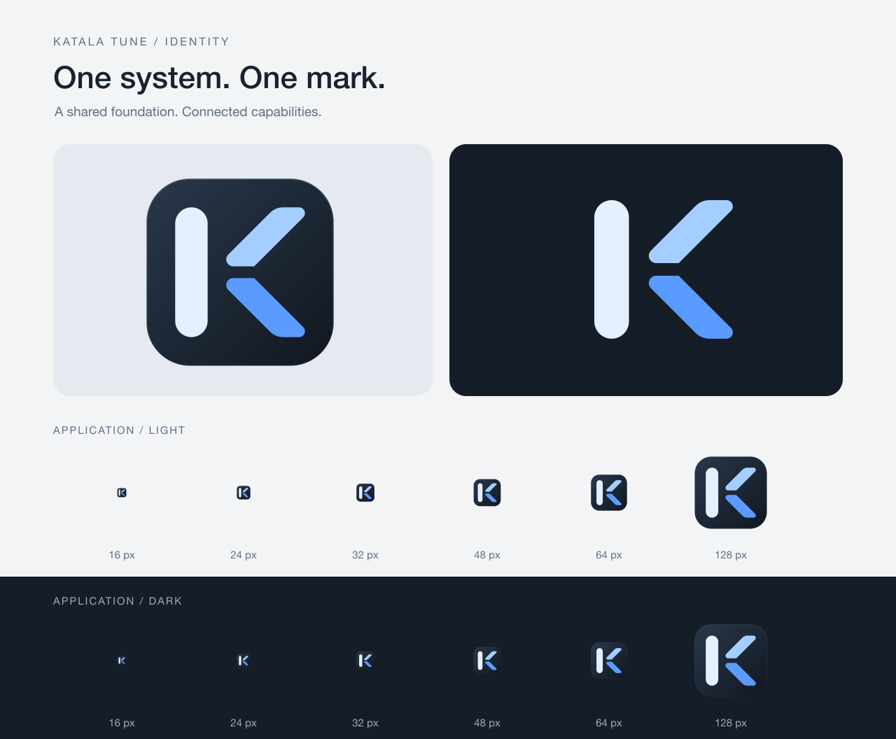

# Katala Tune のマーク

機体、接続、ログ、分析、最適化をひとつのシステムとして扱うため、三つの部品が「K」を形づくるマークにする。左の支柱は基盤、右の二本は集約と展開を表す。特定の機能や機体数に依存せず、輪郭だけでも識別できる形を選んだ。速度計は従来の性能分析をよく表すが、システム全体への展開を考えてこの形に更新した。

グラファイトの台座にアイスブルーと青を合わせる。ロゴの青はブランド色で、正常・注意・異常の状態表示とは独立させる。既存の状態色やOSのアクセント設定には手を加えない。メニューバーには同じ形の黒と透明だけのテンプレート画像を使う。



## 原本と生成

編集する原本は `build/mark.svg`。文字、フォント、外部画像、フィルターには依存しない。macOS の authoring 環境で Node、librsvg (`rsvg-convert`)、ImageMagick (`magick`)、Xcode Command Line Tools (`iconutil`) を用意し、次を実行する。実行時依存は増やさない。

```sh
npm run icons
```

`build/icon.svg`、ICNS、16/24/32/48/64/128/256px の ICO、Tauri の PNG、テンプレート画像の通常／Retina版、Web画面の `renderer/brand-mark.svg`、この文書のプレビューを同じ原本から生成する。生成物もコミットするため、アプリのビルドに描画ツールは不要。

GPUI は原本から生成した128pxの `build/mark.png` を `include_bytes!` で埋め込み、サイドバーに描画する。GPUI 0.2.2 の `ImageFormat::Svg` 経由では赤と青が入れ替わる挙動を実画面で確認したため、PNGの読み込みを使う。起動場所や配布先に原本ファイルがなくても表示できる。Web画面も同じマークを使い、ライト／ダーク両方で読める固定の暗い台座を置く。

## GPUI の macOS バンドル

```sh
npm run gpui:package:mac
```

`dist/Katala Tune GPUI.app` を作り、`CFBundleIconFile` に新しい ICNS を指定する。Tauri と同名の実行ファイルが衝突しないよう、Cargo の出力は `target/gpui` に分離する。識別子は `org.katala.tune.gpui`。既存アプリや実機の台帳を置き換えない。

ローカル確認用の ad-hoc 署名であり、Developer ID署名・公証・自動更新つきの配布は既存のリリース作業として扱う。Windows の ICO と Tauri 用画像は更新するが、GPUI の Windows 配布工程はここでは追加しない。

動作確認は合成台帳と専用のデータ保存先で行う。

```sh
"dist/Katala Tune GPUI.app/Contents/MacOS/katala-tune" \
  --config config/nodes.example.json --data target/brand-smoke --selftest
```
